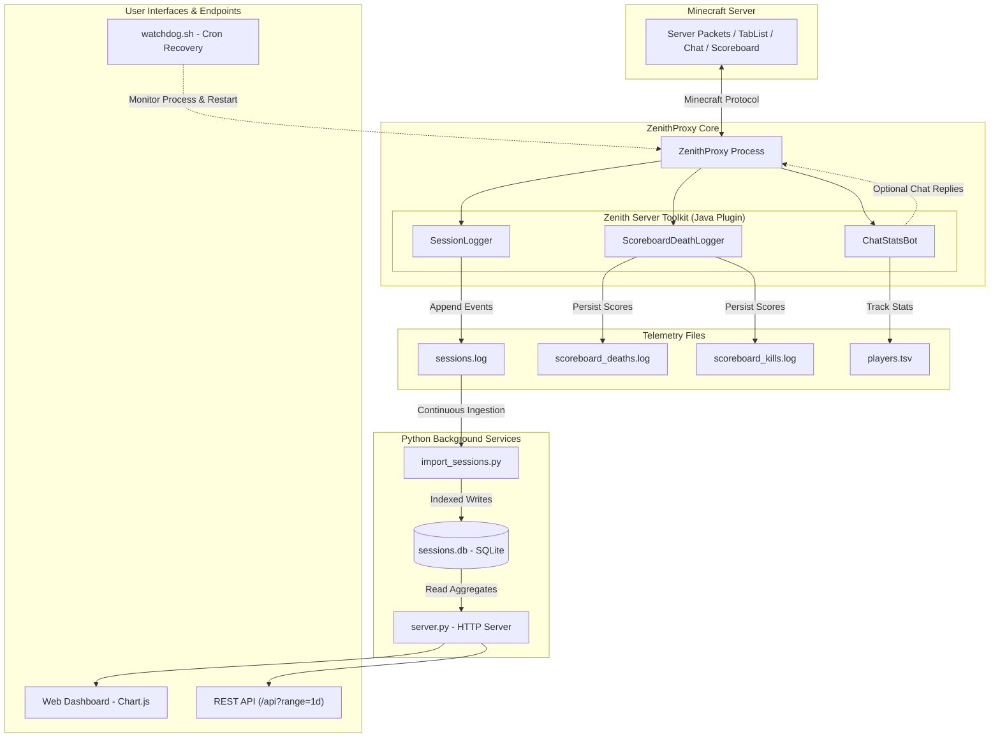

# Zenith Server Toolkit

[](https://github.com/kolsuzmuz/zenith-server-toolkit/actions/workflows/build.yml)
[](https://github.com/kolsuzmuz/zenith-server-toolkit/releases/latest)
[](https://www.gnu.org/licenses/agpl-3.0)
[](https://adoptium.net/)
[](https://www.python.org/)
[](https://github.com/rfresh2/ZenithProxy)

A production-ready monitoring, telemetry, analytics, and automation suite built specifically for [ZenithProxy](https://github.com/rfresh2/ZenithProxy).

Designed for zero-configuration portability across any Linux VDS (Virtual Dedicated Server) or VPS, whether running as `root`, `ubuntu`, or a standard user.

---

## Table of Contents

- [Overview](#overview)
- [Key Features](#key-features)
- [Architecture](#architecture)
- [Quick Start (60 Seconds)](#quick-start-60-seconds)
- [Core Components](#core-components)
- [In-Game Chatbot Details](#in-game-chatbot-details)
  - [Command Reference](#command-reference)
  - [Safety Switch (Dry-Run Mode)](#safety-switch-dry-run-mode)
  - [Spam & Flood Protection](#spam--flood-protection)
- [Configuration Reference](#configuration-reference)
- [Web Dashboard & REST API](#web-dashboard--rest-api)
  - [Dashboard Preview](#dashboard-preview)
  - [REST API Endpoint (`/api`)](#rest-api-endpoint-api)
- [Data Storage & Specifications](#data-storage--specifications)
- [High-Availability Watchdog](#high-availability-watchdog)
- [Directory Structure](#directory-structure)
- [Minecraft Protocol Updates](#minecraft-protocol-updates)
- [Security Best Practices](#security-best-practices)
- [Troubleshooting & FAQ](#troubleshooting--faq)
- [Contributing & License](#contributing--license)

---

## Overview

[ZenithProxy](https://github.com/rfresh2/ZenithProxy) is a standalone Minecraft client proxy that maintains a persistent bot presence on a Minecraft server (such as 2b2t, anarchy servers, or private SMPs) while allowing human players to seamlessly connect and take over control.

**Zenith Server Toolkit** elevates ZenithProxy from a passive proxy into an autonomous server monitoring hub. It observes live in-game network packets, tracks player activity and session lengths, logs deaths and kills, responds to in-game chat commands, and provides an interactive, self-hosted web dashboard with live player count trends.

---

## Key Features

- **Zero Game-Loop Lag:** Heavy database writes and analytics run in isolated asynchronous Python background processes, keeping the Java Minecraft networking loop blazing fast.
- **Interactive In-Game Chatbot:** Answers player queries (`!info`, `!playtime`, `!top`, `!joindate`) with built-in spam protection and an instant dry-run killswitch.
- **Universal Kill & Death Tracking:** Works out of the box on any server via in-game death message parsing (`EVENT` mode), or connects to vanilla/custom server objectives (`SCOREBOARD` mode) with automatic scoreboard discovery.
- **Self-Contained Web Dashboard:** Standalone HTTP server rendering clean Chart.js timelines across 3h, 6h, 12h, 1d, 7d, 15d, and 30d spans, with zero external web server dependencies.
- **Built-In JSON API:** Easily expose live player counts to Discord bots, status pages, or Grafana dashboards.
- **VDS Crash Watchdog:** Monitors proxy process health inside `tmux` sessions and automatically relaunches it upon crash or server reboot.
- **100% Portable:** All scripts dynamically discover paths, users, and environment variables on any Linux VDS without hardcoded paths.

---

## Architecture



---

## Quick Start (60 Seconds)

You do **not** need to compile Java on your VDS. Pre-compiled binaries are generated and published automatically via GitHub Actions.

### 1. Download Plugin to Your Proxy
From your server terminal:
```bash
git clone https://github.com/kolsuzmuz/zenith-server-toolkit.git ~/zenith-server-toolkit
cd ~/zenith-server-toolkit
./scripts/download_plugin.sh
```
*The script automatically detects where ZenithProxy is installed and downloads the latest `.jar`.*

### 2. Start Session Data Importer
Run the background importer (converts `sessions.log` into SQLite `sessions.db`):
```bash
nohup python3 scripts/import_sessions.py --loop > /dev/null 2>&1 &
```

### 3. Launch Web Dashboard
Start the dashboard directly or install it as a systemd service:
```bash
# Option A: Run directly in terminal
python3 site/server.py

# Option B: Install as a permanent background service (1-command)
sudo ./scripts/setup_service.sh
```
*Open `http://<YOUR_VDS_IP>:8080` in your browser.*

### 4. Enable Watchdog (Crash Recovery)
Add to your crontab (`crontab -e`):
```cron
*/5 * * * * flock -n /tmp/watchdog.lock /path/to/zenith-server-toolkit/scripts/watchdog.sh
```

---

## Core Components

### 1. Java Proxy Plugin (`ZenithServerToolkit.jar`)
Hooks into ZenithProxy's event bus without affecting network throughput:
- **`SessionLogger`:** Listens to tab list entries and bot status, logging `JOIN`, `LEAVE`, `HEARTBEAT`, and `BOT_DISCONNECT` events with ISO-8601 UTC timestamps.
- **`ScoreboardDeathLogger`:** Operates in `EVENT` mode (parses death messages like `Steve was blown up by Creeper`) or `SCOREBOARD` mode. Automatically scans and documents active scoreboard objectives into configuration.
- **`ChatStatsBot`:** Parses public chat messages, increments message counters, updates playtime and join records, and answers player commands.

### 2. Session Ingestion Daemon (`import_sessions.py`)
Reads `sessions.log` incrementally using persistent byte offsets, writing clean, indexed rows into `sessions.db` (SQLite). Supports crash detection, bot reconnection handling, and open session reconciliation.

### 3. Web Dashboard & API (`server.py`)
Lightweight, multi-threaded Python HTTP server using standard libraries (`http.server`, `sqlite3`). Queries aggregated player activity over variable time buckets and caches responses for high performance.

### 4. High-Availability Watchdog (`watchdog.sh`)
Verifies proxy process health using `pgrep`. If ZenithProxy crashes or the server reboots, it launches the proxy inside a dedicated `tmux` session and automatically reconnects to the Minecraft server.

---

## In-Game Chatbot Details

### Command Reference

All commands start with an exclamation mark (`!`) in Minecraft public chat. Commands are case-insensitive.

| Command | Aliases | Description | Example |
|---|---|---|---|
| `!info [player]` | `!stats`, `!inf`, `!i` | Complete player dossier: messages, joins, playtime, kills, deaths, first and last seen timestamps. | `!info Steve` |
| `!playtime [player]` | `!pt` | Total accumulated active playtime on the server. | `!playtime` |
| `!messages [player]` | `!msg`, `!messages` | Total public chat messages sent by the player. | `!msg Alex` |
| `!deaths [player]` | *None* | Total deaths recorded for the player. | `!deaths Steve` |
| `!kills [player]` | *None* | Total player-versus-player kills recorded. | `!kills Steve` |
| `!joindate [player]` | `!jd` | Timestamp when the player was first recorded on the server. | `!jd` |
| `!lastseen [player]` | `!ls` | Timestamp when the player was last seen, or "online now". | `!ls Alex` |
| `!top <category>` | *None* | Top 3 server leaderboard (`kills`, `deaths`, `messages`, `playtime`). | `!top playtime` |
| `!seed` | *None* | World seed string configured in `plugins/config/zenith-server-toolkit.json`. | `!seed` |
| `!help` | `!commands` | Lists all available public bot commands. | `!help` |

> [!NOTE]
> When `[player]` is omitted in commands like `!info`, `!playtime`, or `!joindate`, the bot automatically queries the stats of the player who sent the chat message.

---

### Safety Switch (Dry-Run Mode)

To safeguard your proxy account from automated server mutes, anti-spam kick triggers, or accidental chat flooding, the chatbot implements a physical filesystem safety switch:

- **Dry-Run Mode (Default):** When installed, the bot computes replies but **only prints them to the proxy console**:
  ```
  [INFO] [DRY-RUN] Reply for Steve: Steve: 42 messages, playtime 3h12m, deaths 4, first seen 2026-03-01 14:20
  ```
  Zero packets are dispatched to the Minecraft server.

- **Enabling Live In-Game Replies:** Create an empty file named `chatbot_reply.enabled` inside your proxy directory:
  ```bash
  touch ~/zenithproxy/chatbot_reply.enabled
  ```

- **Deactivating Live Replies:** Delete the file to immediately switch back to dry-run mode without restarting the proxy:
  ```bash
  rm ~/zenithproxy/chatbot_reply.enabled
  ```

---

### Spam & Flood Protection

The chatbot includes built-in rate limiters:
1. **Global Rate Limit:** 3 seconds minimum between any two outgoing bot replies.
2. **Per-User Rate Limit:** 8 seconds cooldown per individual player. Commands sent during cooldown are silently discarded.
3. **Loop Suppression:** Replies sent by the bot are kept in a circular buffer to prevent recursive chat feedback loops with other bots.
4. **Length Truncation:** Outgoing messages are sanitized of control characters and capped at 200 characters to prevent packet rejection.

---

## Configuration Reference

After running ZenithProxy once with the plugin installed, configuration is automatically generated at:
`plugins/config/zenith-server-toolkit.json`

```json
{
  "sessionLogger": {
    "enabled": true
  },
  "scoreboardLogger": {
    "enabled": true,
    "dataSource": "EVENT",
    "deathsObjective": "DeathCount",
    "killsObjective": "KillCount",
    "maxDiscoveredScoreboards": 20,
    "discoveredScoreboards": [
      "DeathCount",
      "KillCount"
    ]
  },
  "chatStatsBot": {
    "enabled": true,
    "worldSeed": "0",
    "useSystemTimezone": true,
    "utcOffsetHours": 0
  }
}
```

### Configuration Options Breakdown

| Field | Type | Default | Description |
|---|---|---|---|
| `sessionLogger.enabled` | `boolean` | `true` | Enables recording player connections, leaves, and heartbeats to `sessions.log`. |
| `scoreboardLogger.enabled` | `boolean` | `true` | Enables death and kill tracking. |
| `scoreboardLogger.dataSource` | `string` | `"EVENT"` | `"EVENT"` (Default): Parses in-game death announcement messages. Compatible with all standard servers without server-side scoreboard requirements.<br>`"SCOREBOARD"`: Polls values directly from Minecraft scoreboard objectives. |
| `scoreboardLogger.deathsObjective` | `string` | `"DeathCount"` | Objective name to read when `dataSource` is set to `"SCOREBOARD"`. |
| `scoreboardLogger.killsObjective` | `string` | `"KillCount"` | Objective name to read when `dataSource` is set to `"SCOREBOARD"`. |
| `scoreboardLogger.maxDiscoveredScoreboards` | `integer` | `20` | Maximum number of discovered server scoreboards to record into config before halting automatic discovery. |
| `scoreboardLogger.discoveredScoreboards` | `array` | `[]` | Automatically populated list of scoreboard objectives observed on the server. Inspect this list to find exact objective names. |
| `chatStatsBot.enabled` | `boolean` | `true` | Toggles the in-game chat command bot. |
| `chatStatsBot.worldSeed` | `string` | `"0"` | String returned to players when typing `!seed`. |
| `chatStatsBot.useSystemTimezone` | `boolean` | `true` | When `true`, formats timestamps (`!jd`, `!info`) using the VDS system timezone. |
| `chatStatsBot.utcOffsetHours` | `integer` | `0` | Manual UTC timezone offset in hours, applied only when `useSystemTimezone` is `false`. |

---

## Web Dashboard & REST API

The dashboard provides a responsive dark-mode interface built with Chart.js.

### Testing Locally
```bash
python3 site/server.py
```
Options supported:
- `--host`: Bind address (default: `0.0.0.0` or `HOST` environment variable)
- `--port`: HTTP port (default: `8080` or `PORT` environment variable)
- `--db`: Direct path to `sessions.db` (auto-detected across common locations if omitted)

```bash
# Example with custom settings
python3 site/server.py --host 127.0.0.1 --port 9000 --db /opt/zenithproxy/sessions.db
```

---

### REST API Endpoint (`/api`)

The dashboard exposes an integrated JSON API endpoint for external integrations (e.g. Discord bots, status websites).

#### Request
```http
GET /api?range={span} HTTP/1.1
Host: your-vds-ip:8080
```

#### Supported `range` Values
`3h`, `6h`, `12h`, `1d` *(default)*, `7d`, `15d`, `30d`.

#### Response Example
```json
{
  "step": 360,
  "points": [
    [1773410000, 18],
    [1773410360, 22],
    [1773410720, 25],
    [1773411080, null]
  ],
  "db_found": true
}
```
- `step`: Time resolution in seconds per bucket.
- `points`: Array of `[unix_timestamp, average_player_count]` pairs. `null` indicates no heartbeat was recorded during that bucket.
- `db_found`: `true` if `sessions.db` was located and queried successfully.

---

## Data Storage & Specifications

| File | Format | Purpose |
|---|---|---|
| `sessions.log` | Pipe-delimited (`\|`) | Raw linear event stream: `timestamp\|uuid\|username\|kind`<br>Kinds: `JOIN`, `LEAVE`, `HEARTBEAT`, `SNAPSHOT`, `BOT_DISCONNECT`. |
| `sessions.db` | SQLite 3 | Indexed database populated by `import_sessions.py`. Contains tables `events`, `sessions`, and metadata offsets for instant queries. |
| `players.tsv` | TSV (`\|` delimited) | Master player stats: `uuid\|name\|first_seen\|last_seen\|msgs\|joins\|playtime\|active_session\|old_names`. |
| `scoreboard_deaths.log` | Colon-delimited (` : `) | Persistent death counts: `Username : Count`. |
| `scoreboard_kills.log` | Colon-delimited (` : `) | Persistent PvP kill counts: `Username : Count`. |

---

## High-Availability Watchdog

The watchdog script (`scripts/watchdog.sh`) ensures your monitoring bot never stays offline.

### Features
- Detects running proxy processes via PID inspection.
- 90-second settling delay to prevent race conditions during updates or scheduled reboots.
- Launches the proxy inside a persistent `tmux` session named `proxy_server`.
- Automatically sends the `connect` command to the proxy console after startup.
- Dynamically finds proxy folders, launch scripts, and Java `.jar` files.

### Crontab Installation
```bash
crontab -e
```
Add the following line:
```cron
*/5 * * * * flock -n /tmp/watchdog.lock /path/to/zenith-server-toolkit/scripts/watchdog.sh
```

---

## Directory Structure

```
zenith-server-toolkit/
├── .github/
│   └── workflows/
│       └── build.yml            # CI: builds and publishes .jar automatically on push
├── docs/
│   └── SETUP.md                 # Full end-to-end VDS setup walkthrough
├── plugin/                      # Java Plugin Source Code
│   ├── build.gradle.kts         # Gradle build script (uses ZenithProxy dev plugin)
│   ├── gradle.properties        # Target Minecraft protocol version channel
│   └── src/main/java/
│       └── com/zenith/toolkit/
│           ├── ToolkitPlugin.java
│           ├── ToolkitConfig.java
│           └── module/
│               ├── ChatStatsBot.java
│               ├── ScoreboardDeathLogger.java
│               └── SessionLogger.java
├── scripts/                     # Portable Shell & Python Utilities
│   ├── download_plugin.sh       # Downloads latest pre-built .jar into proxy plugins/
│   ├── import_sessions.py       # Background sessions.log -> SQLite ingestor
│   ├── export_players.py        # Player seed exporter for external databases
│   ├── setup_service.sh         # 1-command systemd service installer for any VDS
│   └── watchdog.sh              # Auto-recovery watchdog for tmux
├── site/                        # Web Dashboard
│   └── server.py                # Standalone HTTP dashboard & JSON API server
├── systemd/
│   └── dashboard.service        # Systemd unit template
└── LICENSE                      # GNU AGPLv3 License
```

---

## Minecraft Protocol Updates

When ZenithProxy releases an update for a new Minecraft version:
1. Open `plugin/gradle.properties`.
2. Update the `mc` variable to the new release channel:
   ```properties
   mc=26.4.0
   ```
3. Commit and push:
   ```bash
   git commit -am "chore: bump mc version to 26.4.0"
   git push
   ```
4. GitHub Actions will compile and publish the new `.jar` artifact to GitHub Releases.
5. On your VDS, run:
   ```bash
   ./scripts/download_plugin.sh
   ```
6. Restart ZenithProxy.

---

## Security Best Practices

1. **Keep Dry-Run Mode Active Initially:** Verify that chat messages parse cleanly in your console before creating `chatbot_reply.enabled`.
2. **Protect the Web Dashboard:** By default, `server.py` binds to `0.0.0.0:8080`. For production servers:
   - Use a **Cloudflare Tunnel** (`cloudflared`) to avoid exposing public ports in your firewall.
   - Or configure an **Nginx reverse proxy** with SSL (`certbot`) and HTTP Basic Authentication.
3. **Database Security:** `server.py` queries `sessions.db` strictly in read-only URI mode (`mode=ro`), preventing accidental SQL injection or database locks.
4. **Systemd Sandboxing:** The generated systemd service includes `NoNewPrivileges=true`, `ProtectSystem=strict`, `ProtectHome=read-only`, and resource constraints (`MemoryMax=80M`).

---

## Troubleshooting & FAQ

### 1. Dashboard says "Database file (sessions.db) not found"
- Ensure `scripts/import_sessions.py` has been started.
- Check that ZenithProxy has been running long enough to generate at least one heartbeat event in `sessions.log`.
- Pass the database path explicitly: `python3 site/server.py --db /path/to/sessions.db`.

### 2. Chatbot is not replying in Minecraft chat
- Check whether `chatbot_reply.enabled` exists in your proxy root folder. Without it, the bot runs in Dry-Run mode.
- Check proxy logs to verify the bot isn't rate-limited.
- Ensure your Minecraft bot account has chat permissions on the target server.

### 3. Watchdog is not restarting ZenithProxy
- Verify `tmux` is installed: `sudo apt install tmux`.
- Ensure the launch script has execution permissions: `chmod +x launch`.
- Test running the script manually: `./scripts/watchdog.sh`.

---

## Contributing & License

Contributions, issues, and feature requests are welcome! Feel free to check the [issues page](https://github.com/kolsuzmuz/zenith-server-toolkit/issues).

Distributed under the **GNU Affero General Public License v3.0 (AGPL-3.0)**, matching ZenithProxy. See [LICENSE](LICENSE) for details.
